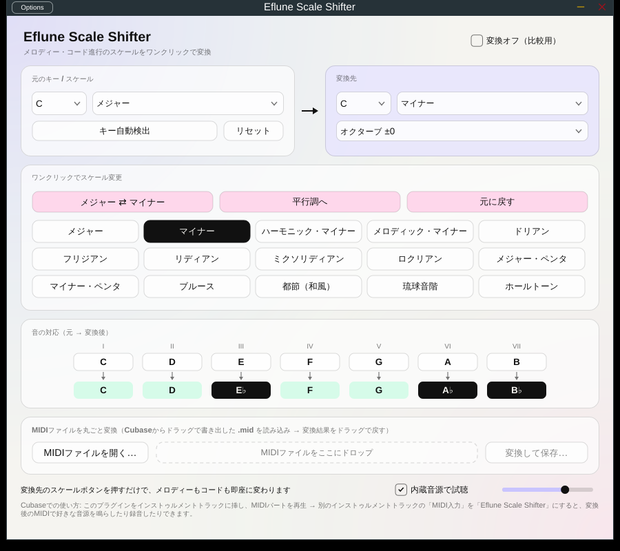

# Eflune Scale Shifter

メロディーやコード進行のスケールを**ボタン一つで**変えられる、Cubase 用の VST3 プラグインです。


C メジャーで作ったフレーズを、ボタンを押すだけで C マイナー、D ドリアン、和風（都節）、琉球音階などに変換します。

## できること

- **スケールボタン（15種類）**：メジャー / マイナー / ハーモニック・マイナー / メロディック・マイナー / ドリアン / フリジアン / リディアン / ミクソリディアン / ロクリアン / メジャー・ペンタ / マイナー・ペンタ / ブルース / 都節（和風） / 琉球音階 / ホールトーン
- **ワンクリック操作**
  - 「メジャー ⇄ マイナー」… 同主調（C メジャー ⇄ C マイナー）を切り替え
  - 「平行調へ」… C メジャー → A マイナー のように平行調へ
  - 「元に戻す」… 変換なしの状態に戻す
- **変換先のキー（移調）とオクターブ**も選べます
- **キー自動検出**：再生されたノート、または読み込んだ MIDI ファイルから元のキーを推定
- **音の対応表**：どの音が何に変わるかを画面で確認できます
- **MIDI ファイルの一括変換**：.mid を読み込み → 変換結果をドラッグで Cubase に戻す / 保存
- **内蔵音源**：プラグイン単体でも変換結果をすぐ試聴できます（オフにも可）
- **変換オフ**ボタンで、元のフレーズと聴き比べ

### 変換のしくみ

- 7音音階どうし（メジャー・マイナー・各モード）は**度数（I〜VII）で対応**させるので、
  コードの形（3和音・7th など）が保たれます。例：C メジャー → C マイナー で C-E-G は C-E♭-G に、
  F-A-C は F-A♭-C になります。
- ペンタトニックなど音数が違うスケールでは、対応する度数があればそれに、なければ最も近いスケール音に寄せます。
- スケール外の音（経過音・ブルーノートなど）は、直下のスケール音からの半音差を保ったまま変換します。
- 演奏中にスケールを切り替えても、ノートオフは必ず「鳴らした音」に送られるので音が残りません。

## インストール

1. GitHub の **Actions → Build Eflune Scale Shifter (VST3)** の最新の実行結果から、
   `EfluneScaleShifter-Windows-VST3` または `EfluneScaleShifter-macOS-VST3` をダウンロードして解凍します。
2. `Eflune Scale Shifter.vst3` を VST3 フォルダにコピーします。
   - Windows: `C:\Program Files\Common Files\VST3\`
   - macOS: `/Library/Audio/Plug-Ins/VST3/`（または `~/Library/Audio/Plug-Ins/VST3/`）
3. macOS では署名していないため、初回はターミナルで次を実行してください：
   ```
   xattr -dr com.apple.quarantine "/Library/Audio/Plug-Ins/VST3/Eflune Scale Shifter.vst3"
   ```
4. Cubase を起動（必要なら「スタジオ → VST プラグインマネージャー」で再スキャン）。

## Cubase での使い方

Cubase は他社製の VST3 を MIDI インサートに挿せないため、このプラグインは**インストゥルメント**として動作し、
変換後の MIDI を出力します。

### A. その場で聴く（いちばん簡単）

1. 「プロジェクト → トラックを追加 → インストゥルメント」で **Eflune Scale Shifter** を選びます。
2. 変換したいメロディーやコードの MIDI パートを、そのトラックに置きます（またはそのまま演奏）。
3. 再生しながらスケールボタンを押すと、内蔵音源で即座に変換後の音が鳴ります。

### B. 好きな音源で鳴らす・録音して確定する

1. A の手順で Eflune Scale Shifter のトラックを用意し、内蔵音源をオフにします。
2. 別のインストゥルメントトラック（HALion Sonic、Groove Agent など）を作り、
   インスペクターの **「入力のルーティング（MIDI 入力）」** を **「Eflune Scale Shifter」** に設定し、モニターを ON にします。
3. 再生すると、変換後の MIDI でその音源が鳴ります。
4. そのトラックで録音すれば、変換後の MIDI が新しいパートとして残ります。

### C. MIDI ファイルとして変換する

1. Cubase で MIDI パートを選び「ファイル → 書き出し → MIDI ループ」などで .mid に書き出します
   （エクスプローラー / Finder へドラッグできる環境ならそれでも OK）。
2. プラグイン画面の「MIDI ファイルを開く…」、または画面へ .mid をドロップします。
3. 「キー自動検出」で元のキーを推定し、変換先のスケールボタンを押します。
4. 緑のタイル「ここをドラッグして Cubase へ」をプロジェクトにドラッグするか、「変換して保存…」で保存します。

## ビルド方法（開発者向け）

必要なもの：CMake 3.22 以上、C++17 コンパイラ（Windows: Visual Studio 2022 / macOS: Xcode）。
JUCE 8 は自動でダウンロードされます。

```bash
cmake -S ScaleShifter -B build -DCMAKE_BUILD_TYPE=Release
cmake --build build --config Release
ctest --test-dir build -C Release   # 変換エンジンの単体テスト
```

成果物は `build/EfluneScaleShifter_artefacts/Release/VST3/` に出力されます（スタンドアロン版も同時にビルドされます）。
ローカルの JUCE を使う場合は `-DJUCE_PATH=/path/to/JUCE` を指定してください。

### ファイル構成

| ファイル | 内容 |
| --- | --- |
| `Source/ScaleEngine.h` | スケール定義と変換・キー検出のロジック（JUCE 非依存） |
| `Source/PluginProcessor.*` | リアルタイム MIDI 変換、パラメータ、内蔵音源 |
| `Source/PluginEditor.*` | 画面（スケールボタン、対応表、ファイル変換） |
| `Source/MidiFileConverter.*` | .mid ファイルの一括変換 |
| `Source/PreviewSynth.h` | 試聴用のシンプルな音源 |
| `Tests/ScaleEngineTests.cpp` | 変換エンジンの単体テスト |
